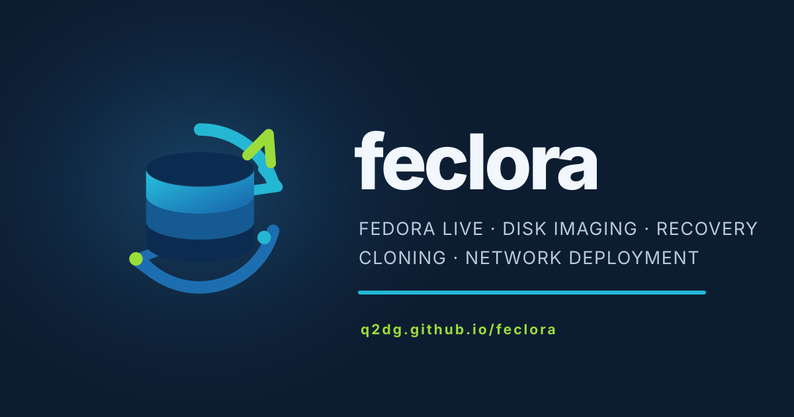
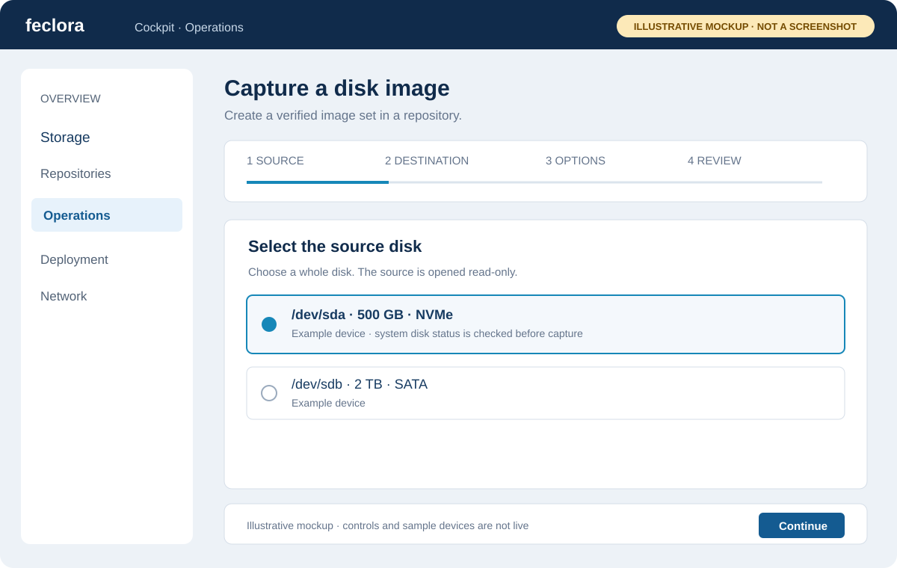
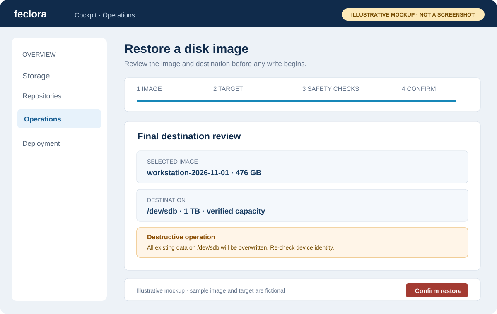
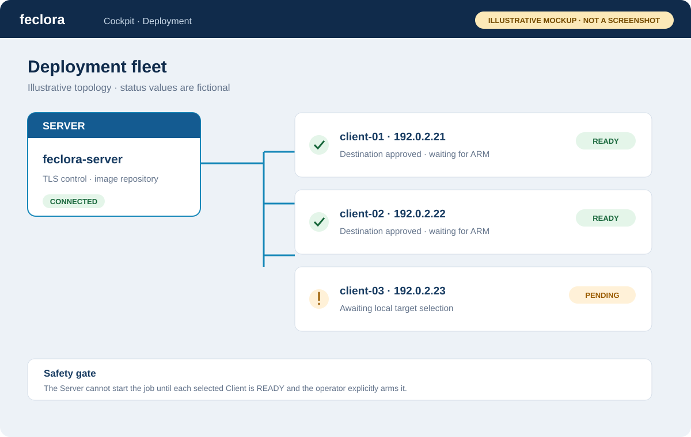

<p align="center">
  
</p>

**Feclora** is a Fedora Server-based minimal Live appliance for disk imaging, cloning, recovery and network deployment. It boots into a locked-down Firefox kiosk that opens the Feclora Cockpit application; it has no general-purpose desktop.

Project website: https://q2dg.github.io/feclora/

**New here?** Start with the [step-by-step operator guides](https://q2dg.github.io/feclora/GETTING-STARTED.html).

## Workflow previews

These are illustrative UI mockups, not screenshots from a running system.

| Capture | Restore | Network deployment |
|---|---|---|
|  |  |  |
| [Capture guide](https://q2dg.github.io/feclora/WHOLE-DISK-CAPTURE.html) | [Restore guide](https://q2dg.github.io/feclora/WHOLE-DISK-RESTORE.html) | [Deployment guide](https://q2dg.github.io/feclora/DEPLOYMENT-SETUP.html) |


## Current implementation

- Fedora Linux 45, x86_64, with a Fedora Live image build pipeline for BIOS and UEFI.
- Cockpit web interface (React + PatternFly), launched in a Firefox kiosk.
- Local whole-disk and partition capture, restore and cloning.
- Capture and restore of eligible active LVM logical volumes.
- Image manifests, compression, SHA-256 integrity verification and optional age encryption. Manifests are not digitally signed.
- Storage and image inventories, safe-target checks, operation progress and local operation journals.
- Persistent Server/Client services, managed Server identity, Client enrollment and Server-authenticated TLS control and unicast transfer.
- UDPcast multicast restore and remote whole-disk / partition cloning.
- Network configuration and PXE/iPXE interactive Live boot.
- An unattended PXE workflow using the same managed repositories as the Live application for whole-disk restore.

The Live session is ephemeral. Credentials, certificates and temporary configuration are regenerated at boot. Images and other durable artifacts are stored in repositories selected by the operator.

## Current limitations

- SSHFS, NFS and SMB/CIFS file repositories are implemented. S3 has a separate object API, encrypted credentials, local capture/restore staging, and distributed Client capture/restore through the Server's authenticated TLS transfer path. Live-provider acceptance against Garage, R2 and AWS S3 is a separate maintainer-run release-acceptance gate, not a substitute for software tests.
- Unattended PXE selects a repository ID and resolves it through the Live client's normal SSHFS, NFS, SMB/CIFS or S3 manager; credentials remain in the normal protected Live configuration.
- Multi-device Btrfs imaging, snapshot-assisted storage capture and several advanced LUKS/LVM workflows are not supported.
- Automated tests and source validation do not prove ISO boot, firmware compatibility or physical-hardware acceptance.

See the [operator guides](docs/GUIDES.md), [feature matrix](docs/FEATURE-MATRIX.md), [build instructions](docs/BUILD.md), [operational lifecycle runbook](docs/OPERATIONS.md), [maintainer acceptance checklist](docs/MAINTAINER-ACCEPTANCE.md) and [remaining work](docs/ROADMAP.md).

## Build and test

Follow [docs/BUILD.md](docs/BUILD.md) for build-host prerequisites, image build commands and BIOS/UEFI QEMU checks. ISO generation and physical-hardware acceptance are operator-run.

## Repository layout

```text
feclora/
├── .github/workflows/   # CI, tests and documentation deployment
├── build/               # Live image and frontend build scripts
├── docs/                # Operator, build and implementation documentation
├── kickstart/           # Fedora Live image configuration
├── packages/            # Runtime and build-host package manifests
├── src/feclora/         # Python backend and privileged operations
├── tests/               # Automated tests and acceptance procedures
├── webui/               # Cockpit React/PatternFly application
├── Makefile
└── README.md
```

## License

GNU General Public License v3.0 or later. See [LICENSE](LICENSE).
