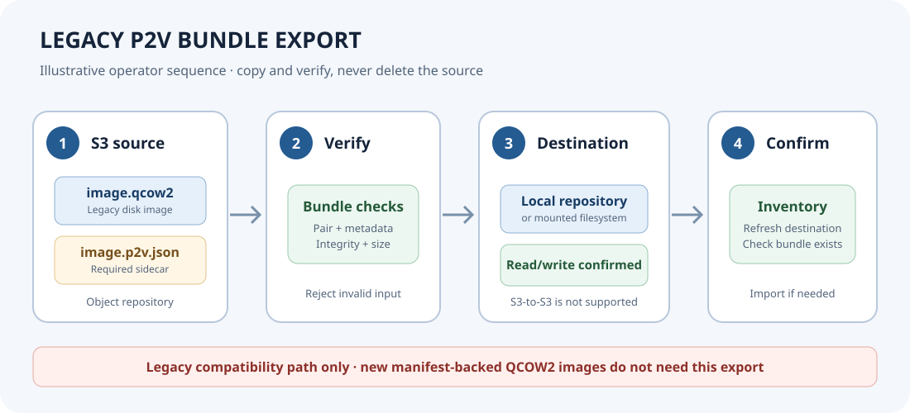

<link rel="stylesheet" href="{{ '/assets/css/site.css' | relative_url }}">


# Export a legacy P2V bundle from S3

This procedure copies a **legacy** P2V bundle (QCOW2 plus its `.p2v.json` sidecar) from an S3-compatible object repository to the local image repository or a mounted filesystem repository. It verifies the source bundle before publication.

> New QCOW2 captures are ordinary manifest-backed Feclora disk images. They already use the normal image workflow and do not need this compatibility export.

## Before you start

- Configure an S3 object repository in Textual and import its S3 credential through the encrypted credential manager.
- Ensure the S3 repository contains the legacy image and matching `.p2v.json` sidecar.
- If exporting to SSHFS, NFS or SMB/CIFS, mount the destination and verify its mount identity. The destination must be read/write.
- If exporting locally, ensure the local repository has enough free space.

## Procedure

<ol>
<li>Open Textual and select <strong>Repositories</strong>.</li>
<li>In <strong>S3 object repositories</strong>, use <strong>Test connection</strong> on the source repository. Resolve credential, endpoint or bucket errors before continuing.</li>
<li>Scroll to <strong>Legacy P2V bundle export from S3</strong>.</li>
<li>Choose the source S3 repository.</li>
<li>Enter the legacy P2V image identifier exactly as stored in that repository. Do not add the `.qcow2` suffix.</li>
<li>Choose <strong>Local repository</strong>, or select a mounted, identity-verified, read/write filesystem repository.</li>
<li>Select <strong>Export legacy P2V bundle</strong>. The operation runs in the durable worker; Textual disconnection does not cancel it.</li>
<li>Follow progress and the terminal result in the notification and <strong>Operation log</strong>. On failure, inspect the operation details and destination before retrying.</li>
</ol>

*Illustrative mockup, not a live screenshot. The S3 export controls are implemented in Textual; the drawing is conceptual.*

## Verify the result

After a successful export, refresh the image inventory for the destination repository and verify that the legacy P2V bundle is present. Import it through the P2V compatibility workflow if you need to convert it into a native Feclora manifest-backed disk image. Do not treat the existence of the copied files alone as proof that a virtual machine will boot.

## Safety and limitations

- The export is a copy; it does not delete the S3 source.
- The S3 repository is object storage, not a mounted filesystem.
- The export destination is local or a mounted filesystem repository; S3-to-S3 copying is not this workflow.
- This compatibility operation is not required for new manifest-backed QCOW2 captures.
- QCOW2 conversion preserves disk sectors and partition metadata but does not repair guest drivers, initramfs, bootloader or BIOS/UEFI configuration.
- Do not place credentials or age passphrases in image identifiers, repository paths or notes.
